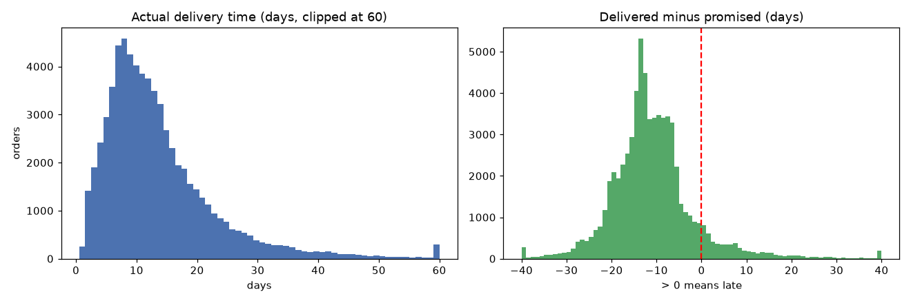
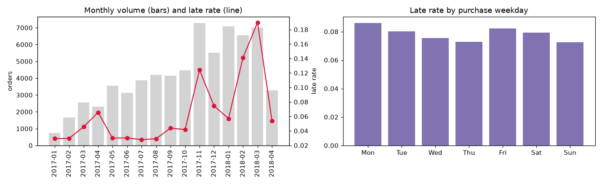
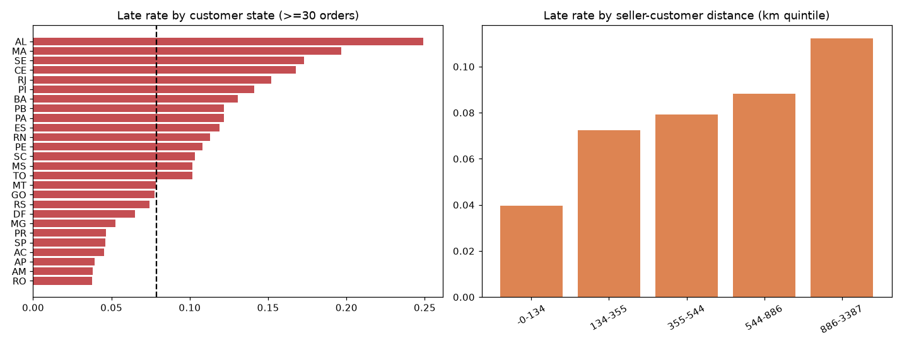
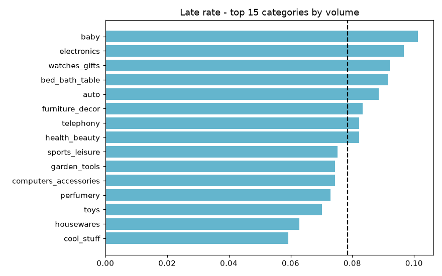
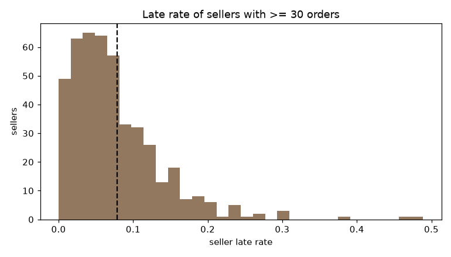
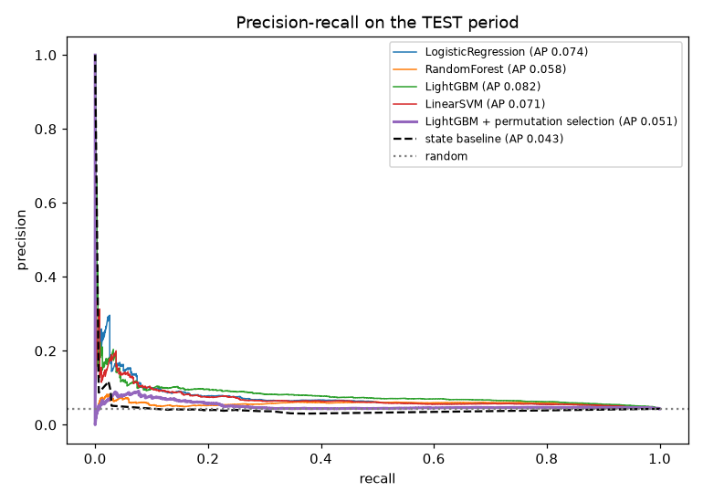
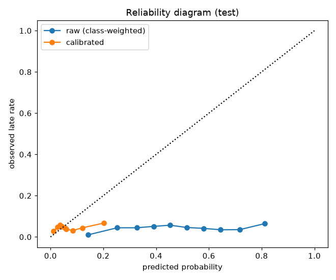
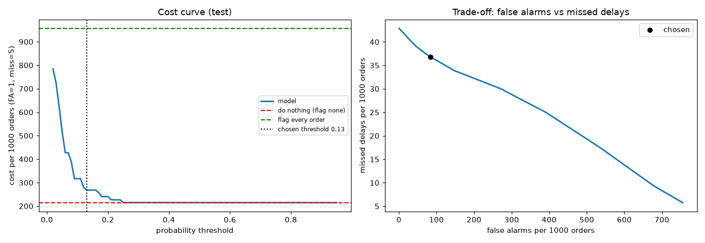
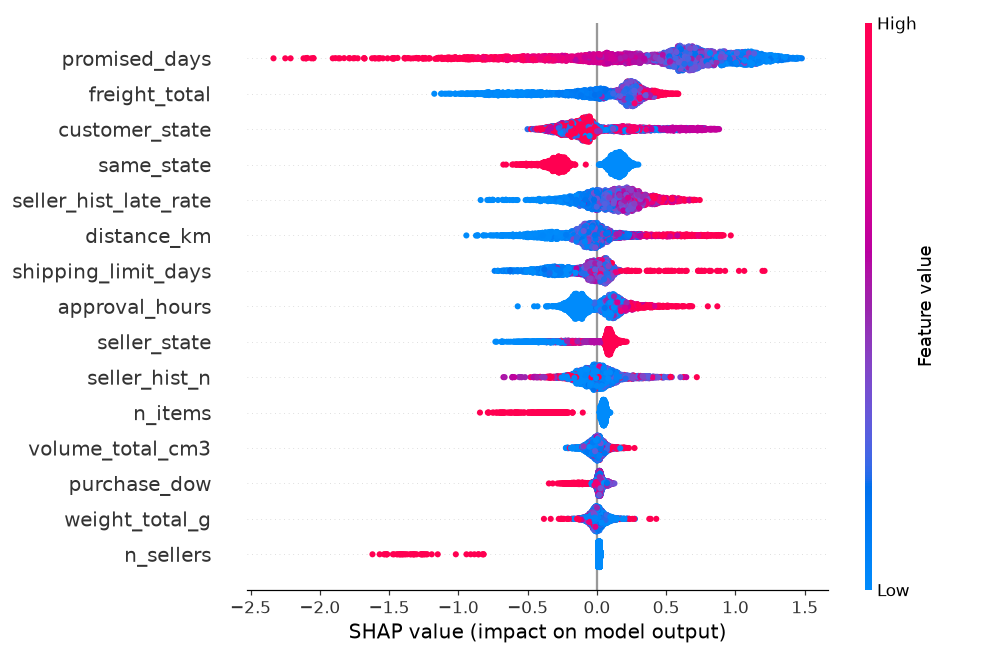

# Delivery-delay prediction - Olist

_Generated in 131s from `C:\Users\DELL\Downloads\Udaan1\data`_

## 1. Data-quality report

| table | rows | columns | duplicate_rows | missing_cells_pct | columns_with_missing |
|---|---|---|---|---|---|
| orders | 99441 | 8 | 0 | 0.62 | order_approved_at (0.2%), order_delivered_carrier_date (1.8%), order_delivered_customer_date (3.0%) |
| items | 112650 | 7 | 0 | 0.00 | - |
| customers | 99441 | 5 | 0 | 0.00 | - |
| sellers | 3095 | 4 | 0 | 0.00 | - |
| payments | 103886 | 5 | 0 | 0.00 | - |
| products | 32951 | 9 | 0 | 0.83 | product_category_name (1.9%), product_name_lenght (1.9%), product_description_lenght (1.9%), product_photos_qty (1.9%), product_weight_g (0.0%), product_length_cm (0.0%), product_height_cm (0.0%), product_width_cm (0.0%) |
| geolocation | 1000163 | 5 | 261831 | 0.00 | - |
| reviews | 99224 | 7 | 0 | 21.01 | review_comment_title (88.3%), review_comment_message (58.7%) |
| translation | 71 | 2 | 0 | 0.00 | - |

Timestamp / consistency checks on `orders`:

| index | rows | pct_of_orders |
|---|---|---|
| approved before purchase | 0 | 0.00 |
| handed to carrier before purchase | 166 | 0.17 |
| delivered before purchase | 0 | 0.00 |
| delivered before carrier hand-over | 23 | 0.02 |
| estimated date before purchase | 0 | 0.00 |
| status 'delivered' but no delivery date | 8 | 0.01 |
| delivery date but status not 'delivered' | 6 | 0.01 |
| orders without items | 775 | 0.78 |
| orders without payment rows | 1 | 0.00 |
| duplicate order_id | 0 | 0.00 |

## 2. Target and population

**Target:** `late = 1` if the order's delivery **calendar day** is after `order_estimated_delivery_date` (the promise shown to the customer at checkout).

**Cancelled / unavailable / undelivered orders are excluded** from training and evaluation: their outcome is not a delivery, so 'late vs on time' is undefined, and labelling them late would teach the model to predict cancellations. They are reported here so the exclusion is visible:

| order_status | orders |
|---|---|
| delivered | 96478 |
| shipped | 1107 |
| canceled | 625 |
| unavailable | 609 |
| invoiced | 314 |
| processing | 301 |
| created | 5 |
| approved | 2 |

Row funnel:

| index | orders |
|---|---|
| all orders | 99441 |
| minus impossible timestamps | 99441 |
| delivered and with a delivery date | 96470 |
| purchased between 2017-01-01 and 2018-09-02 | 96203 |

Orders bought in the final 45 days are dropped because only the fast ones have a delivery date (right-censoring would make the late rate look too low).

## 3. Leakage audit

Excluded because they are only known after delivery:

- `order_delivered_customer_date` - The outcome itself (actual delivery timestamp).
- `order_delivered_carrier_date` - Carrier hand-over happens days after purchase and partly reveals the outcome.
- `order_status` - Final status (delivered / canceled / unavailable) is only known at the end of the order.
- `delivery_days, delay_days` - Derived from the delivery timestamp - used for EDA only, never as features.
- `reviews table (review_score, comments, review dates)` - Written after delivery and strongly driven by lateness.

Used (known when the order is placed/approved): order_purchase_timestamp, order_approved_at (minutes/hours after purchase), order_estimated_delivery_date (the promise shown to the customer), items / products / freight / payment / customer & seller location, seller history from orders delivered BEFORE this purchase.

## 4. EDA findings (training period only)

- **7.9%** of delivered orders in the training period arrived after the promised date.
- Median delivery takes **11.4 days** (90th pct 25.0) while the median promise is **23.6 days** - promises are padded, so lateness is a tail event, not the typical case.
- When an order is late it is late by a median **7.8 days**.
- **Seasonality:** late rate peaks for orders bought in **2018-03** (19.0%) vs a low of 2.8% in 2017-07 - peak periods (Black Friday / holidays, carnival) overload the logistics network.
- **Region:** worst destination states are AL (24.9%), MA (19.7%), SE (17.3%); best are RO (3.8%), AM (3.8%), AP (3.9%).
- **Distance:** late rate goes from 4.0% in the nearest distance quintile to 11.2% in the farthest.
- **Category:** among the 15 largest categories, **baby** is late most often (10.1%) and **cool_stuff** least (5.9%).
- **Sellers:** of 456 sellers with >= 30 orders, 10% are late more than twice the average; the worst 10% of them cause 14% of those sellers' late orders -> seller history is a strong signal.

## 5. Split

Chronological by purchase date - train < 2018-04-16 <= validation < 2018-06-21 <= test. Sizes: 67,342 / 14,430 / 14,431. Late rate: 7.9% / 4.3% / 4.3%. No random split.

## 6. Baseline vs models (same split)

Imbalance handled with class weights (`balanced`, `scale_pos_weight`). Model chosen on **validation** PR-AUC; test columns are reported for transparency only.

| index | val_PR_AUC | val_ROC_AUC | test_PR_AUC | test_ROC_AUC | fit_seconds |
|---|---|---|---|---|---|
| Baseline: late rate of destination state | 0.064 | 0.624 | 0.043 | 0.439 | 0.000 |
| LogisticRegression | 0.123 | 0.750 | 0.074 | 0.634 | 1.291 |
| RandomForest | 0.122 | 0.739 | 0.058 | 0.624 | 10.758 |
| LightGBM | 0.122 | 0.754 | 0.082 | 0.677 | 3.445 |
| LinearSVM | 0.122 | 0.749 | 0.071 | 0.627 | 4.562 |
| LogisticRegression + L1 selection | 0.118 | 0.755 | 0.067 | 0.632 |  |
| LightGBM + permutation selection | 0.132 | 0.758 | 0.051 | 0.543 |  |

## 7. Feature selection (before / after)

- **L1 logistic regression** (C=0.02) zeroed 86 of 126 encoded columns. Val PR-AUC 0.123 -> 0.118.
- **Permutation importance** on LightGBM (validation, PR-AUC drop) kept 17 of 23 features. Val PR-AUC 0.122 -> 0.132. Dropped: purchase_month, price_total, freight_ratio, installments, n_payments, category.

| index | importance_mean | importance_std |
|---|---|---|
| promised_days | 0.0511 | 0.0027 |
| distance_km | 0.0421 | 0.0013 |
| customer_state | 0.0233 | 0.0025 |
| same_state | 0.0103 | 0.0026 |
| freight_total | 0.0085 | 0.0032 |
| seller_hist_late_rate | 0.0044 | 0.0011 |
| shipping_limit_days | 0.0034 | 0.0020 |
| n_sellers | 0.0030 | 0.0016 |
| n_items | 0.0024 | 0.0004 |
| weight_total_g | 0.0021 | 0.0008 |
| approval_hours | 0.0020 | 0.0009 |
| seller_state | 0.0015 | 0.0011 |
| purchase_hour | 0.0013 | 0.0004 |
| seller_hist_n | 0.0009 | 0.0010 |
| volume_total_cm3 | 0.0007 | 0.0007 |

## 8. Final model: **LightGBM + permutation selection** - calibration and operating point

| index | Brier (lower is better) | mean predicted prob | actual late rate |
|---|---|---|---|
| raw (class-weighted) model | 0.2734 | 0.4837 | 0.0429 |
| isotonic-calibrated | 0.0437 | 0.0603 | 0.0429 |

Costs: false alarm = 1, missed delay = 5. Threshold chosen on validation by minimum cost: **0.13** (theory for calibrated probabilities: 0.17).

Test-period results at that threshold:

| index | value |
|---|---|
| PR_AUC | 0.051 |
| ROC_AUC | 0.543 |
| threshold | 0.130 |
| precision | 0.067 |
| recall | 0.142 |
| flagged_pct | 9.043 |
| false_alarms_per_1000 | 84.332 |
| missed_delays_per_1000 | 36.796 |
| cost_per_1000 | 268.311 |

Cost per 1000 orders: model **268.3** vs do-nothing 214.5 vs flag-everything 957.1.

## 9. Error analysis (test)

By region:

| customer_region | orders | late_rate | flagged_rate | recall | precision | PR_AUC | missed_delays | false_alarms |
|---|---|---|---|---|---|---|---|---|
| Southeast | 10199.000 | 0.047 | 0.056 | 0.075 | 0.063 | 0.052 | 444.000 | 534.000 |
| South | 1921.000 | 0.023 | 0.080 | 0.114 | 0.032 | 0.026 | 39.000 | 149.000 |
| Northeast | 1250.000 | 0.046 | 0.350 | 0.632 | 0.082 | 0.086 | 21.000 | 402.000 |
| Center-West | 836.000 | 0.038 | 0.132 | 0.281 | 0.082 | 0.064 | 23.000 | 101.000 |
| North | 225.000 | 0.027 | 0.147 | 0.333 | 0.061 | 0.066 | 4.000 | 31.000 |

By seller group (past delivered orders at purchase time):

| seller_group | orders | late_rate | flagged_rate | recall | precision | PR_AUC | missed_delays | false_alarms |
|---|---|---|---|---|---|---|---|---|
| new (0 past orders) | 637.000 | 0.041 | 0.055 | 0.115 | 0.086 | 0.102 | 23.000 | 32.000 |
| small (1-9) | 2365.000 | 0.041 | 0.049 | 0.031 | 0.026 | 0.046 | 94.000 | 112.000 |
| medium (10-49) | 3321.000 | 0.042 | 0.057 | 0.100 | 0.074 | 0.052 | 126.000 | 175.000 |
| large (50+) | 8108.000 | 0.044 | 0.119 | 0.191 | 0.070 | 0.052 | 288.000 | 898.000 |

By state (>= 50 test orders):

| customer_state | orders | late_rate | flagged_rate | recall | precision | PR_AUC | missed_delays | false_alarms |
|---|---|---|---|---|---|---|---|---|
| SP | 6732.000 | 0.058 | 0.004 | 0.023 | 0.375 | 0.084 | 380.000 | 15.000 |
| RJ | 1622.000 | 0.038 | 0.220 | 0.339 | 0.059 | 0.054 | 41.000 | 336.000 |
| MG | 1574.000 | 0.013 | 0.090 | 0.250 | 0.035 | 0.020 | 15.000 | 137.000 |
| PR | 743.000 | 0.022 | 0.057 | 0.125 | 0.048 | 0.028 | 14.000 | 40.000 |
| RS | 718.000 | 0.025 | 0.070 | 0.056 | 0.020 | 0.028 | 17.000 | 49.000 |
| SC | 460.000 | 0.022 | 0.135 | 0.200 | 0.032 | 0.033 | 8.000 | 60.000 |
| BA | 456.000 | 0.037 | 0.353 | 0.647 | 0.068 | 0.074 | 6.000 | 150.000 |
| DF | 355.000 | 0.034 | 0.101 | 0.167 | 0.056 | 0.041 | 10.000 | 34.000 |
| GO | 275.000 | 0.029 | 0.138 | 0.500 | 0.105 | 0.128 | 4.000 | 34.000 |
| ES | 271.000 | 0.033 | 0.173 | 0.111 | 0.021 | 0.038 | 8.000 | 46.000 |
| PE | 241.000 | 0.050 | 0.286 | 0.583 | 0.101 | 0.133 | 5.000 | 62.000 |
| CE | 165.000 | 0.006 | 0.400 | 1.000 | 0.015 | 0.040 | 0.000 | 65.000 |
| PA | 114.000 | 0.026 | 0.219 | 0.333 | 0.040 | 0.063 | 2.000 | 24.000 |
| MT | 110.000 | 0.000 | 0.145 |  | 0.000 |  | 0.000 | 16.000 |
| MS | 96.000 | 0.125 | 0.208 | 0.250 | 0.150 | 0.162 | 9.000 | 17.000 |
| PB | 90.000 | 0.056 | 0.311 | 0.600 | 0.107 | 0.108 | 2.000 | 25.000 |
| MA | 82.000 | 0.134 | 0.402 | 0.727 | 0.242 | 0.226 | 3.000 | 25.000 |
| RN | 60.000 | 0.000 | 0.417 |  | 0.000 |  | 0.000 | 25.000 |
| PI | 58.000 | 0.086 | 0.293 | 0.400 | 0.118 | 0.138 | 3.000 | 15.000 |
| SE | 52.000 | 0.038 | 0.385 | 0.500 | 0.050 | 0.079 | 1.000 | 19.000 |

## 10. SHAP - top drivers

| feature | mean_abs_shap | direction |
|---|---|---|
| promised_days | 0.6548 | higher value -> lower late risk |
| freight_total | 0.2743 | higher value -> higher late risk |
| customer_state | 0.2160 | categorical (effect depends on the level) |
| same_state | 0.2139 | higher value -> lower late risk |
| seller_hist_late_rate | 0.2004 | higher value -> higher late risk |
| distance_km | 0.1949 | higher value -> higher late risk |
| shipping_limit_days | 0.1578 | higher value -> higher late risk |
| approval_hours | 0.1455 | higher value -> higher late risk |
| seller_state | 0.1354 | categorical (effect depends on the level) |
| seller_hist_n | 0.1080 | non-linear / weak |
| n_items | 0.0821 | higher value -> lower late risk |
| volume_total_cm3 | 0.0434 | higher value -> higher late risk |

