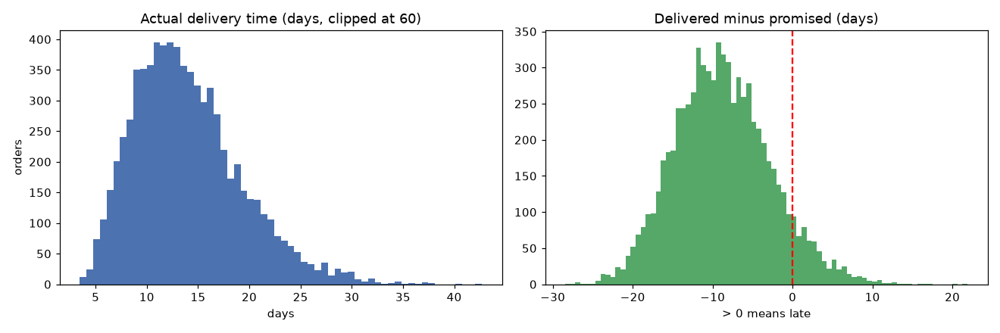
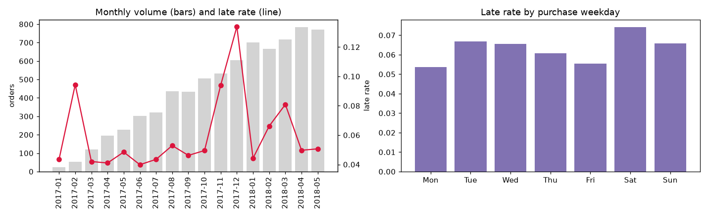
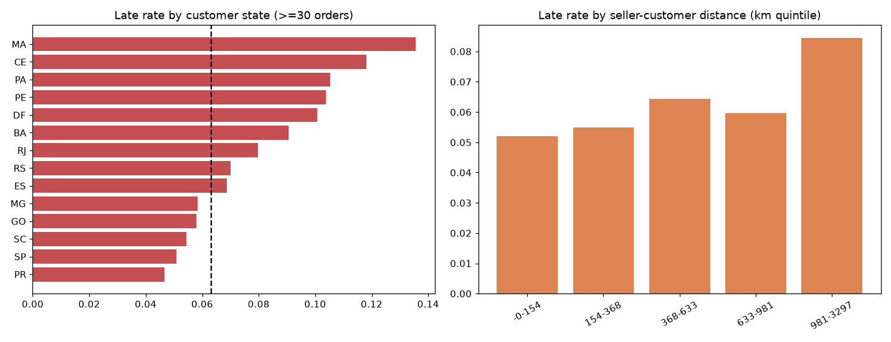
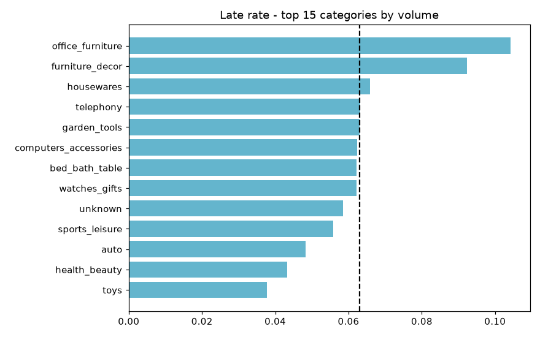
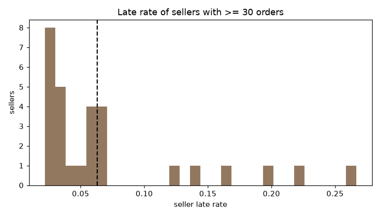
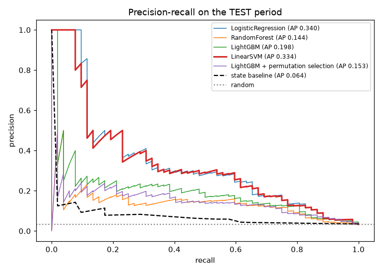
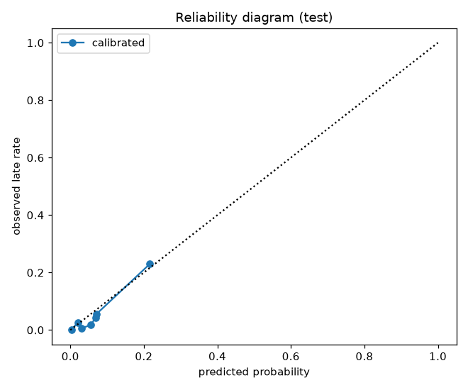
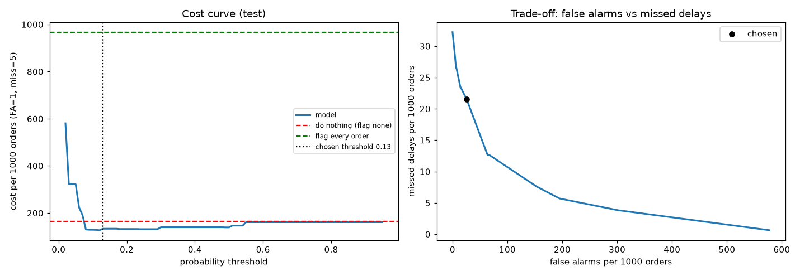
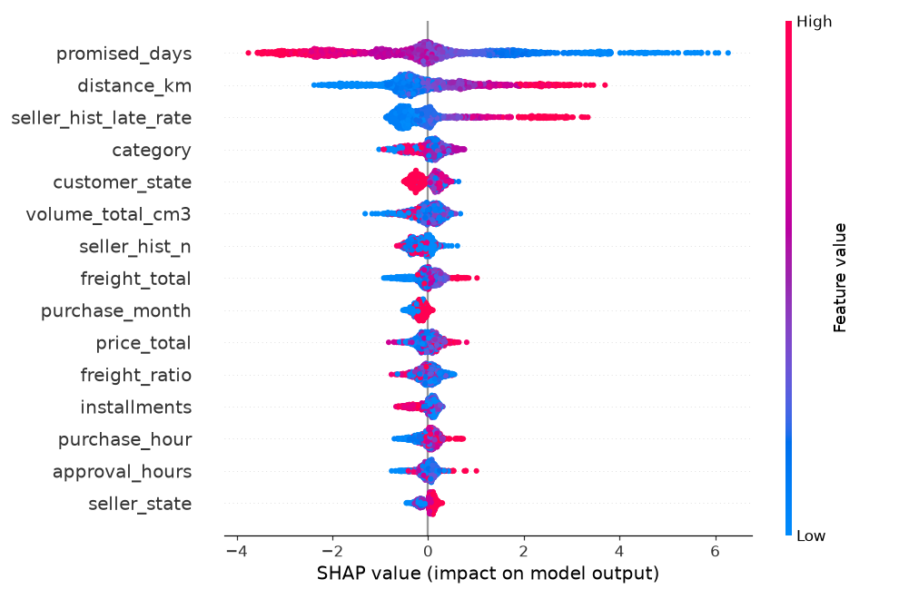

# Delivery-delay prediction - Olist

_Generated in 12s from `C:\Users\Sanjeev\Downloads\udaan\delivery_delay_prediction\data_sample`_

## 1. Data-quality report

| table | rows | columns | duplicate_rows | missing_cells_pct | columns_with_missing |
|---|---|---|---|---|---|
| orders | 12000 | 8 | 0 | 0.83 | order_approved_at (0.2%), order_delivered_carrier_date (2.6%), order_delivered_customer_date (3.8%) |
| items | 16705 | 7 | 0 | 0.00 | - |
| customers | 12000 | 5 | 0 | 0.00 | - |
| sellers | 250 | 4 | 0 | 0.00 | - |
| payments | 12360 | 5 | 0 | 0.00 | - |
| products | 800 | 9 | 0 | 0.43 | product_category_name (2.6%), product_weight_g (0.6%), product_length_cm (0.6%) |
| geolocation | 1090 | 5 | 40 | 0.00 | - |
| reviews | 12000 | 7 | 0 | 29.67 | review_comment_title (100.0%), review_comment_message (100.0%), review_creation_date (3.8%), review_answer_timestamp (3.8%) |
| translation | 12 | 2 | 0 | 0.00 | - |

Timestamp / consistency checks on `orders`:

| index | rows | pct_of_orders |
|---|---|---|
| approved before purchase | 4 | 0.03 |
| handed to carrier before purchase | 0 | 0.00 |
| delivered before purchase | 4 | 0.03 |
| delivered before carrier hand-over | 5 | 0.04 |
| estimated date before purchase | 0 | 0.00 |
| status 'delivered' but no delivery date | 0 | 0.00 |
| delivery date but status not 'delivered' | 0 | 0.00 |
| orders without items | 0 | 0.00 |
| orders without payment rows | 0 | 0.00 |
| duplicate order_id | 0 | 0.00 |

## 2. Target and population

**Target:** `late = 1` if the order's delivery **calendar day** is after `order_estimated_delivery_date` (the promise shown to the customer at checkout).

**Cancelled / unavailable / undelivered orders are excluded** from training and evaluation: their outcome is not a delivery, so 'late vs on time' is undefined, and labelling them late would teach the model to predict cancellations. They are reported here so the exclusion is visible:

| order_status | orders |
|---|---|
| delivered | 11539 |
| shipped | 146 |
| canceled | 144 |
| unavailable | 102 |
| invoiced | 69 |

Row funnel:

| index | orders |
|---|---|
| all orders | 12000 |
| minus impossible timestamps | 11992 |
| delivered and with a delivery date | 11531 |
| purchased between 2017-01-01 and 2018-09-01 | 10553 |

Orders bought in the final 45 days are dropped because only the fast ones have a delivery date (right-censoring would make the late rate look too low).

## 3. Leakage audit

Excluded because they are only known after delivery:

- `order_delivered_customer_date` - The outcome itself (actual delivery timestamp).
- `order_delivered_carrier_date` - Carrier hand-over happens days after purchase and partly reveals the outcome.
- `order_status` - Final status (delivered / canceled / unavailable) is only known at the end of the order.
- `delivery_days, delay_days` - Derived from the delivery timestamp - used for EDA only, never as features.
- `reviews table (review_score, comments, review dates)` - Written after delivery and strongly driven by lateness.

Used (known when the order is placed/approved): order_purchase_timestamp, order_approved_at (minutes/hours after purchase), order_estimated_delivery_date (the promise shown to the customer), items / products / freight / payment / customer & seller location, seller history from orders delivered BEFORE this purchase.

## 4. EDA findings (training period only)

- **6.3%** of delivered orders in the training period arrived after the promised date.
- Median delivery takes **13.2 days** (90th pct 21.1) while the median promise is **22.6 days** - promises are padded, so lateness is a tail event, not the typical case.
- When an order is late it is late by a median **3.2 days**.
- **Seasonality:** late rate peaks for orders bought in **2017-12** (13.4%) vs a low of 4.0% in 2017-06 - peak periods (Black Friday / holidays, carnival) overload the logistics network.
- **Region:** worst destination states are MA (13.6%), CE (11.8%), PA (10.5%); best are PR (4.7%), SP (5.1%), SC (5.4%).
- **Distance:** late rate goes from 5.2% in the nearest distance quintile to 8.5% in the farthest.
- **Category:** among the 15 largest categories, **office_furniture** is late most often (10.4%) and **toys** least (3.8%).
- **Sellers:** of 29 sellers with >= 30 orders, 17% are late more than twice the average; the worst 10% of them cause 6% of those sellers' late orders -> seller history is a strong signal.

## 5. Split

Chronological by purchase date - train < 2018-05-29 <= validation < 2018-07-19 <= test. Sizes: 7,387 / 1,583 / 1,583. Late rate: 6.3% / 4.4% / 3.3%. No random split.

## 6. Baseline vs models (same split)

Imbalance handled with class weights (`balanced`, `scale_pos_weight`). Model chosen on **validation** PR-AUC; test columns are reported for transparency only.

| index | val_PR_AUC | val_ROC_AUC | test_PR_AUC | test_ROC_AUC | fit_seconds |
|---|---|---|---|---|---|
| Baseline: late rate of destination state | 0.078 | 0.605 | 0.064 | 0.642 | 0.000 |
| LogisticRegression | 0.310 | 0.832 | 0.340 | 0.878 | 0.152 |
| RandomForest | 0.216 | 0.806 | 0.144 | 0.809 | 0.908 |
| LightGBM | 0.260 | 0.811 | 0.198 | 0.848 | 2.852 |
| LinearSVM | 0.310 | 0.832 | 0.334 | 0.878 | 0.115 |
| LogisticRegression + L1 selection | 0.300 | 0.827 | 0.249 | 0.871 |  |
| LightGBM + permutation selection | 0.270 | 0.808 | 0.153 | 0.833 |  |

## 7. Feature selection (before / after)

- **L1 logistic regression** (C=0.02) zeroed 47 of 61 encoded columns. Val PR-AUC 0.310 -> 0.300.
- **Permutation importance** on LightGBM (validation, PR-AUC drop) kept 18 of 23 features. Val PR-AUC 0.260 -> 0.270. Dropped: purchase_month, n_sellers, same_state, installments, seller_state.

| index | importance_mean | importance_std |
|---|---|---|
| promised_days | 0.1752 | 0.0078 |
| seller_hist_late_rate | 0.1063 | 0.0039 |
| distance_km | 0.0784 | 0.0112 |
| category | 0.0231 | 0.0118 |
| customer_state | 0.0222 | 0.0084 |
| purchase_hour | 0.0196 | 0.0050 |
| freight_total | 0.0178 | 0.0072 |
| weight_total_g | 0.0153 | 0.0091 |
| seller_hist_n | 0.0131 | 0.0037 |
| freight_ratio | 0.0127 | 0.0160 |
| payment_type | 0.0121 | 0.0019 |
| price_total | 0.0115 | 0.0108 |
| approval_hours | 0.0107 | 0.0107 |
| volume_total_cm3 | 0.0043 | 0.0047 |
| shipping_limit_days | 0.0030 | 0.0047 |

## 8. Final model: **LinearSVM** - calibration and operating point

| index | Brier (lower is better) | mean predicted prob | actual late rate |
|---|---|---|---|
| raw (class-weighted) model |  |  | 0.0328 |
| isotonic-calibrated | 0.0270 | 0.0433 | 0.0328 |

Costs: false alarm = 1, missed delay = 5. Threshold chosen on validation by minimum cost: **0.13** (theory for calibrated probabilities: 0.17).

Test-period results at that threshold:

| index | value |
|---|---|
| PR_AUC | 0.266 |
| ROC_AUC | 0.878 |
| threshold | 0.130 |
| precision | 0.305 |
| recall | 0.346 |
| flagged_pct | 3.727 |
| false_alarms_per_1000 | 25.900 |
| missed_delays_per_1000 | 21.478 |
| cost_per_1000 | 133.291 |

Cost per 1000 orders: model **133.3** vs do-nothing 164.2 vs flag-everything 967.2.

## 9. Error analysis (test)

By region:

| customer_region | orders | late_rate | flagged_rate | recall | precision | PR_AUC | missed_delays | false_alarms |
|---|---|---|---|---|---|---|---|---|
| Southeast | 1117.000 | 0.027 | 0.027 | 0.300 | 0.300 | 0.238 | 21.000 | 21.000 |
| South | 246.000 | 0.024 | 0.033 | 0.333 | 0.250 | 0.207 | 4.000 | 6.000 |
| Northeast | 119.000 | 0.118 | 0.101 | 0.429 | 0.500 | 0.552 | 8.000 | 6.000 |
| Center-West | 75.000 | 0.013 | 0.080 | 0.000 | 0.000 | 0.020 | 1.000 | 6.000 |
| North | 26.000 | 0.038 | 0.115 | 1.000 | 0.333 | 1.000 | 0.000 | 2.000 |

By seller group (past delivered orders at purchase time):

| seller_group | orders | late_rate | flagged_rate | recall | precision | PR_AUC | missed_delays | false_alarms |
|---|---|---|---|---|---|---|---|---|
| small (1-9) | 103.000 | 0.029 | 0.058 | 0.333 | 0.167 | 0.292 | 2.000 | 5.000 |
| medium (10-49) | 470.000 | 0.040 | 0.049 | 0.316 | 0.261 | 0.205 | 13.000 | 17.000 |
| large (50+) | 1010.000 | 0.030 | 0.030 | 0.367 | 0.367 | 0.372 | 19.000 | 19.000 |

By state (>= 50 test orders):

| customer_state | orders | late_rate | flagged_rate | recall | precision | PR_AUC | missed_delays | false_alarms |
|---|---|---|---|---|---|---|---|---|
| SP | 669.000 | 0.025 | 0.022 | 0.235 | 0.267 | 0.168 | 13.000 | 11.000 |
| MG | 221.000 | 0.009 | 0.032 | 1.000 | 0.286 | 0.750 | 0.000 | 5.000 |
| RJ | 195.000 | 0.046 | 0.031 | 0.333 | 0.500 | 0.427 | 6.000 | 3.000 |
| RS | 99.000 | 0.040 | 0.030 | 0.250 | 0.333 | 0.442 | 3.000 | 2.000 |
| PR | 81.000 | 0.000 | 0.012 |  | 0.000 |  | 0.000 | 1.000 |
| BA | 66.000 | 0.091 | 0.045 | 0.167 | 0.333 | 0.396 | 5.000 | 2.000 |
| SC | 66.000 | 0.030 | 0.061 | 0.500 | 0.250 | 0.178 | 1.000 | 3.000 |

## 10. SHAP - top drivers (computed on LightGBM; final model is LinearSVM)

| feature | mean_abs_shap | direction |
|---|---|---|
| promised_days | 1.3739 | higher value -> lower late risk |
| distance_km | 0.7330 | higher value -> higher late risk |
| seller_hist_late_rate | 0.5403 | higher value -> higher late risk |
| category | 0.2595 | categorical (effect depends on the level) |
| customer_state | 0.2186 | categorical (effect depends on the level) |
| volume_total_cm3 | 0.2120 | higher value -> lower late risk |
| seller_hist_n | 0.1921 | higher value -> lower late risk |
| freight_total | 0.1825 | higher value -> higher late risk |
| purchase_month | 0.1700 | higher value -> higher late risk |
| price_total | 0.1568 | higher value -> higher late risk |
| freight_ratio | 0.1567 | higher value -> lower late risk |
| installments | 0.1453 | higher value -> lower late risk |

